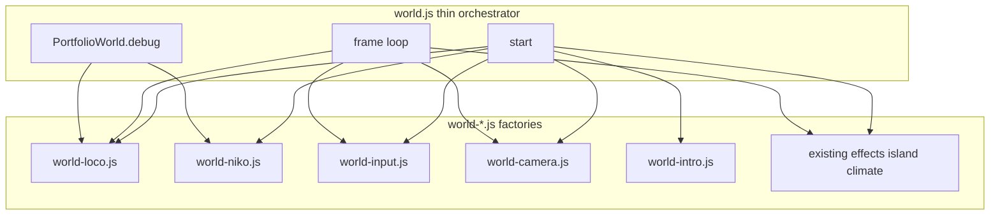

# Modularize world.js for long-term / AI-friendly updates

## Verdict

Yes. [world.js](world.js) (~6500 lines inside one `start()`) is past the point where “add it next to the last change” is safe. The repo already has the right pattern—[world-play-log.js](world-play-log.js), [world-foot-dust.js](world-foot-dust.js), [world-niko-hitboxes.js](world-niko-hitboxes.js), [world-boss.js](world-boss.js)—factories that take deps and return a small API. Finish that pattern; do **not** invent a new framework (ECS, event bus, DI container).

esbuild already bundles any `import` from [world.js](world.js) ([build-world.mjs](/.impeccable/tools/build-world.mjs)); splitting files does not change the IIFE/`file://` story.

## Why it’s hard

Almost everything closes over shared live state: `state`, `bot`, `robot`, `keys`, mixer phases, camera goals. A bad split either:

- creates circular imports, or
- copies state and drifts, or
- still dumps new features into `world.js` because ownership is unclear.

So the design goal is **clear ownership + one shared context**, not “fewer lines at all costs.”

## Architecture (chosen)

**Shared context** (one plain object built in `start`, passed into factories):

- `ctx.state`, `ctx.bot`, `ctx.robot`, `ctx.scene`, `ctx.camera`, `ctx.clock` knobs (`SPEED`, `STOP`, `TURN180`, …)
- Modules **mutate** `ctx.state` / bones; they do not own a second copy
- Return a narrow API: `{ step, startStop, cancelStop, … }` matching today’s `StopLoco` / `TurnLoco` shape

This matches existing `createFootDust({ scene, camera })` style—just make the bag explicit.

## What stays vs what moves

| Keep in world.js (orchestrator) | Extract first |
| --- | --- |
| `start()`, renderer/scene wiring, `PortfolioWorld` debug surface, frame loop that *calls* modules | Locomotion: `poseInertia`, `StopLoco`, `TurnLoco`, gait mix, sprint/stop constants |
| Thin glue that passes `dt` and reads `moving` / keys | Niko load/retarget: `useNikoModel`, clip actions, hair/eyes fit |
| | Input: keyboard, stick, pointer (not pathfinding—already removed) |
| | Camera follow / orbit / zoom goals |
| | Intro / boot starfield / `playIntro` timeline |

Already-good modules stay: island, climate, rain, rays, smear, hitboxes, wind, boss, play-log, dev-map.

## Agent / long-term rules (required with the split)

1. **One owner file per concern** — e.g. stop/180/gait → only [world-loco.js](world-loco.js). Agents must not re-open a 6k dump.
2. **Update [.cursor/rules/core-memory.mdc](.cursor/rules/core-memory.mdc)** with a short “where to edit” map (loco / niko / input / camera / intro).
3. **Add [.agents/skills or a short WORLD.md](.agents/skills/niko-animation/SKILL.md)** pointer: “locomotion changes → world-loco.js + verify-*.mjs; never paste new loco into world.js.”
4. **Public debug API stays stable**: `PortfolioWorld.sprint`, `debug.bot`, `debug.state` keep working so checks and your console workflow don’t break.
5. **Every extract phase**: move code → rebuild → run the existing verify script for that area → no behavior knobs “while we’re here.”

## Phased extraction (behavior-preserving)

### Phase 1 — Locomotion (highest AI collision zone)

New [world-loco.js](world-loco.js):

- `STOP`, `TURN180`, `poseInertia`, `StopLoco`, `TurnLoco`
- gait soft-blend / `gaitMix` / phase match hooks used by the mixer block
- `createLoco(ctx) → { step, onStopStart, onTurnStart, poseInertia, … }`

[world.js](world.js) frame loop only calls `loco.step(dt)` / uses returned helpers. Verify: `verify-stop.mjs`, `verify-turn-180.mjs`, `verify-gait-blend.mjs`, `verify-turn-180-gap.mjs`.

### Phase 2 — Niko body + clips

New [world-niko.js](world-niko.js): `useNikoModel`, `directClip`, hemisphere match, actions map, eye/hair seating. Returns `bot` + load promise. Verify: existing niko checks / load still reveals world.

### Phase 3 — Input + camera

- [world-input.js](world-input.js): keys, stick, touch → `ctx.state.keys` / move intent
- [world-camera.js](world-camera.js): yaw/pitch/zoom damp, lock framing

### Phase 4 — Intro / boot

[world-intro.js](world-intro.js): starfield `field`, boot HUD, `playIntro` GSAP timeline. Keep GSAP-only-on-wrappers rule.

### Phase 5 — Trim orchestrator

What remains in `world.js` should read as a table of contents (~800–1500 lines): create ctx → create systems → wire debug → loop.

## Explicit non-goals

- No TypeScript migration in this effort
- No renaming `world.bundle.js` / changing the build entry beyond importing new modules
- No gameplay tuning while extracting
- No mega “utils” junk drawer—if it’s loco, it goes in loco

## Success criteria

- Same play feel; verify scripts green for touched systems
- New stop/180/gait work lands in `world-loco.js` only
- core-memory “where to edit” table exists so agents don’t guess
- `world.js` line count drops in clear steps (Phase 1 alone should remove ~800–1200 lines)
